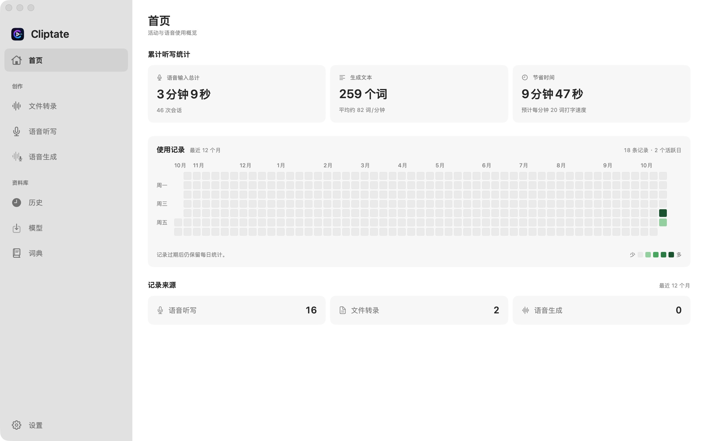

# Cliptate

[English](README.md) · [中文](README.zh.md) · [日本語](README.ja.md) · [한국어](README.ko.md) · [Deutsch](README.de.md)

这是 [Cliptate 官方网站](https://cliptate.github.io) 的源码仓库。macOS 应用源码在 [cliptate/cliptate](https://github.com/cliptate/cliptate)。网站内容以应用主分支的代码和文档为依据，安装包的功能以对应 Release 为准。

在 Mac 上完成转写、去停顿、字幕编辑和语音合成，按需启用 AI 纠错与翻译。免费 GitHub 版开放全部模型和 Pro 功能，也能通过 CLI 接入脚本。



*首页展示累计听写统计、最近 12 个月的使用记录和记录来源。*

## 核心能力

- **字幕提取精准且可编辑** — 选择 Parakeet、Qwen3 ASR、FireRed 或 Cohere 模型，在 Mac 上转写音视频；使用词典辅助专有词识别。
- **批量去停顿，粗剪更快成型** — 自动检测无声片段，批量裁剪播客、访谈、课程录音中的冗余停顿。
- **自动区分说话人，标注对话结构** — 在支持的转写流程中使用 Sortformer 区分说话人；Silero VAD 检测语音活动，让访谈和会议记录更易整理。
- **从旁白补录到原创音色** — Qwen3 TTS 支持预设音色、参考音频克隆、情感控制和音色设计；按所选模型使用对应能力。
- **按需纠错，生成双语字幕** — 使用已配置的 AI 服务商和 API 密钥纠正文字、提取重点，支持自定义 OpenAI 兼容端点。字幕翻译通过 Apple 翻译完成，语言对需受系统支持。
- **让口播更有节奏和重点** — 配置语气词过滤、画面缩放与推近；通过已配置的 AI 服务提取重点，并设置横竖屏字幕样式和翻译位置。

## 下载与安装

需要 Apple Silicon（M1 及更新芯片）和 macOS 15 或更新版本。模型大小与内存需求取决于所选模型，请预留足够空间。

- **[GitHub 免费版](https://github.com/cliptate/cliptate/releases)** — 全部模型与 Pro 功能免费开放，无需订阅。提供原生 CLI 和应用内更新；可在授权后使用辅助功能支持的文本输入与全局快捷键。在线 AI 服务的费用由服务商另行收取。
- **[App Store 版](https://apps.apple.com/cn/app/%E5%89%AA%E8%A8%80-cliptate/id6754441004?mt=12)** — 通过 App Store 获取的版本采用订阅策略和沙盒限制，不包含 CLI。听写文本通过复制粘贴使用，快捷键行为也受该渠道限制；功能与价格以商店页面为准。
- **[Nightly 预览构建](https://github.com/cliptate/cliptate/releases/tag/nightly)** — Nightly 随主分支定期构建，可能包含尚未正式发布的改动。请查看对应构建说明确认功能。

1. 下载 Release 中的 Cliptate.dmg，将应用拖入「应用程序」。可用同页的 SHA-256 文件校验下载。
2. 打开应用，选择并下载模型；使用听写时允许麦克风访问，需要自动输入时再授权辅助功能。
3. 导入素材开始转写。使用 CLI 前先完成安装；升级替换应用后，重新启动 Cliptate。

## 原生 CLI · GitHub 版

CLI 复用应用的模型、语言和词典，必要时在后台启动 Cliptate。从「设置 → 命令行」复制安装命令，并将 ~/.local/bin 加入 PATH。

```sh
cliptate transcribe interview.mp4 --format json
cliptate transcribe a.wav b.mp4 --format vtt --output-dir subtitles
cliptate tts --text-file narration.txt -o narration.wav --download
cliptate dictionary add "Cliptate"
cliptate dictionary import words.txt
```

转写支持本地文件及 text、JSON、Markdown、SRT、VTT 输出。CLI 不创建项目或历史记录；一次运行一个转写或语音生成请求。TTS 命令已加入最新源码，请选用包含该功能的构建；旧版可用 cliptate --help 查看支持的命令。

[完整 CLI 使用指南](https://github.com/cliptate/cliptate/blob/main/docs/cli.md)

## 隐私与性能

转写、静音检测、说话人识别与 TTS 在 Mac 上运行。启用在线 AI 功能时，相关文本及你选择的上下文会发送至配置的服务。

- 本地语音推理无需上传音视频，也不需要 AI API 密钥。
- 首次下载模型需要联网；缓存完成后，本地语音功能可离线使用。
- AI 纠错、重点提取与听写增强使用你配置的服务；在线服务可能另行收费。
- 处理敏感内容时，可仅使用本地语音功能与 Apple 翻译；翻译语言包可能需要先下载。

## 专业输出

AI 剪辑界面支持时间线、字幕与音视频导出；CLI 另外提供 JSON、Markdown 和 VTT，方便自动化。

- **FCPXML** — 适配时间线工程交换
- **SRT** — 通用字幕交付
- **ASS** — 样式化字幕支持
- **TXT** — 带时间戳的文字稿

FCPXML 面向 Final Cut Pro，并提供 Resolve 兼容选项。字幕可按剪辑软件支持的格式导入；视频支持 MP4 / MOV / M4V，音频支持 M4A / WAV。

## 网站开发

网站使用 Astro、TypeScript 和 Tailwind CSS。需要 Node.js 22.12 或更新版本。

```sh
npm ci
npm run dev
npm run check
npm run build
npm run check:seo
npm run preview
```

构建输出在 dist/。main 分支推送后，.github/workflows/deploy.yml 会构建并发布到 GitHub Pages。

## 文章与竞品对比

`/blog/` 汇总 Cliptate 与 Wispr Flow、MacWhisper、Descript 的对比。每篇包含工作流差异、版本说明、试用建议及带核对日期的官方来源，提供五种语言。首页的简洁入口与导航可进入文章。`/guide/` 集中提供安装、模型、CLI 示例和常见问题，让首页聚焦产品介绍。

## 内容维护

`/changelog/` 列表和 `/changelog/<tag>/` 详情以五种语言展示 v1.0–v1.4，主导航和首页页脚均提供入口。详情包含功能变化、升级说明、已知限制、GitHub 原始发布记录及完整的英文验证与提交记录。页面输出静态 HTML，提供 Article/ItemList 结构化数据、本地化面包屑和按实际内容更新时间生成的 sitemap `lastmod`。

新增已发布的正式版本时，核对 `cliptate/cliptate/docs/release-notes/<tag>.md` 与 GitHub Release，在 `src/data/release-metadata.json` 添加元信息，并在 `src/data/changelog.ts` 翻译所有字段。`date` 是原文版本日期，`published` 是官网条目首次发布日，`updated` 是内容修改日；编辑时保留 `published`，仅在内容实质变化时更新 `updated`。路由、语言链接、版本排序、结构化数据和 sitemap 日期均自动生成。Nightly 和 main 中未发布的功能不进入正式版本列表。官网记录需显式维护，不在运行时获取或自动同步发布记录。

中文保留原有根路径；英文、日文、韩文和德文分别使用 `/en/`、`/ja/`、`/ko/` 和 `/de/`，覆盖指南与文章。每个 URL 无需 JavaScript 即可呈现单一语言，包含对应元数据、自引用 canonical、双向 hreflang 和站点地图语言关系。语言链接保留当前页面，浏览器语言偏好不会覆盖 URL 指定的语言。

页面模板位于 `src/views/`，`src/pages/` 负责静态路由。构建后运行 `npm run check:seo`，检查所有语言页面、站内链接、锚点、图片、核心元数据和结构化数据关系。部署会在发布前运行类型与 SEO 检查。上线后向 Google Search Console 与 Bing Webmaster Tools 提交 `/sitemap-index.xml`，通过这些平台观察收录和排名。FAQ JSON-LD 描述页面中的问答；Google [已停止显示 FAQ 富结果](https://developers.google.com/search/updates#june-2026)，这里不将其作为 Google 富结果优化手段。

修改功能描述前，核对应用源码、docs/development.md、docs/cli.md 和版本说明。同步更新五种语言，区分本地语音与可选在线 AI、GitHub 与 App Store 渠道、界面与 CLI 输出，以及已发布与最新源码中的能力。

- src/data/site.ts
- src/views/
- scripts/check-seo.py
- src/data/guide.ts
- src/data/blog.ts
- src/data/changelog.ts 和 src/data/release-metadata.json
- src/pages/changelog/
- src/pages/blog/
- src/pages/guide/
- src/components/SiteHeader.astro
- src/styles/editorial.css
- src/pages/index.astro
- src/components/LanguageToggle.astro
- public/assets/screenshots/

[使用指南](https://github.com/cliptate/cliptate#readme) · [版本说明](https://github.com/cliptate/cliptate/tree/main/docs/release-notes) · [问题与反馈](https://github.com/cliptate/cliptate/issues)
